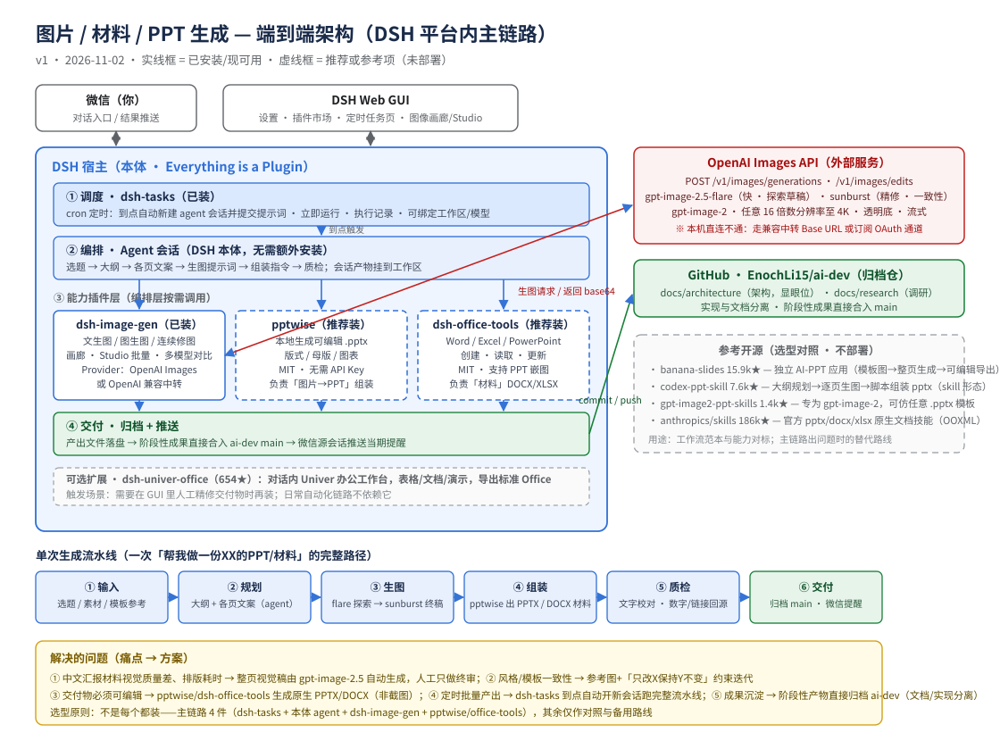
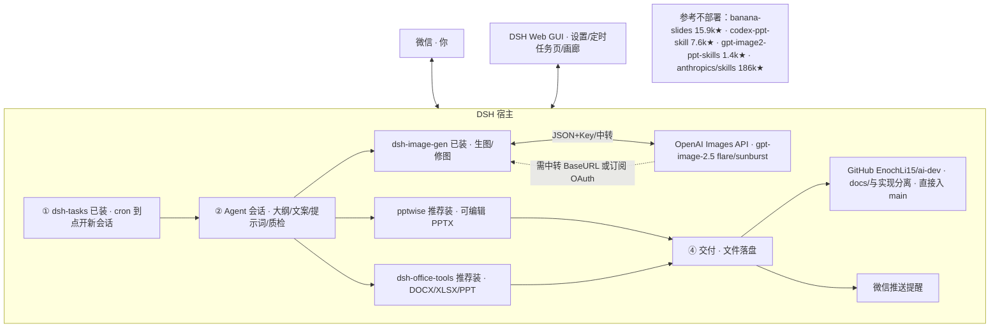

# 图片 / 材料 / PPT 生成 — 端到端架构设计

> 版本：v1（2026-11-02）· 配套调研：[docs/research/openai-image-generation.md](../research/openai-image-generation.md)
> 架构图：[media-generation-pipeline.svg](media-generation-pipeline.svg)（下方亦有 Mermaid 源码版）
> 归档约定：阶段性成果直接合入 main（仓库所有者 2026-11-02 授权）；文档与实现分离，架构文档置于 `docs/architecture/` 显眼位置。

## 0. 一句话结论

**不是每个项目都装。** 主链路只用 4 件、全部运行在 DSH 平台内：`dsh-tasks`（定时调度，已装）+ DSH 本体 agent（编排，零安装）+ `dsh-image-gen`（生图，已装）+ `pptwise`/`dsh-office-tools`（可编辑交付，推荐装）。外部大项目（banana-slides、codex-ppt-skill、gpt-image2-ppt-skills、anthropics/skills）只做**选型对照与备用路线**，不部署。

## 1. 选型矩阵（怎么选、每个负责什么）

| 层 | 项目 | Star | 协议 | 状态 | 负责什么 | 为什么选它 |
|---|---|---|---|---|---|---|
| 调度 | `@weibaohui/dsh-tasks` | 10 | MIT | **已装** | cron 到点自动开新会话执行提示词；执行记录、立即运行 | 与「定时产出材料」场景精确对口，单插件零依赖 |
| 编排 | DSH 本体 agent | —（本体） | MIT/BSD | **现成** | 选题→大纲→文案→生图提示词→组装指令→质检 | 平台原生，无需引入外部编排器 |
| 生图 | `dsh-image-gen` | 1066 | Apache-2.0 | **已装** | 文生图/图生图/连续修图、画廊、Studio 批量、多模型对比；Provider 支持 OpenAI Images 与兼容中转 | 平台内生图插头部，OpenAI Provider 原生支持 |
| PPT 交付 | `pptwise` | 27 | MIT | 推荐装 | 本地生成**可编辑** .pptx（版式/母版/图表，无需 Key） | 「图片→PPT」组装的最短路径 |
| 材料交付 | `dsh-office-tools` | 41 | MIT | 推荐装 | Word/Excel/PPT 创建读取更新、PPT 嵌图 | DOCX/XLSX 材料与嵌图互补 pptwise |
| 可选 | `dsh-univer-office` | 654 | Apache-2.0 | 暂缓 | GUI 内 Univer 办公工作台、导出标准 Office | 需要人工精修交付物时再装 |
| 对照 | `banana-slides` | 15937 | **AGPL-3.0** | 不部署 | 独立 AI-PPT 应用：模板图上传→素材解析→整页生成→可编辑导出 | 路线标杆；AGPL + 独立应用形态，不适合并入本仓 |
| 对照 | `codex-ppt-skill` | 7564 | MIT | 不部署 | skill：大纲规划→逐页生图→脚本组装 pptx | 工作流范本，思路已被主链路吸收 |
| 对照 | `gpt-image2-ppt-skills` | 1420 | Apache-2.0 | 不部署 | 专为 gpt-image-2：一句话→整页图→pptx；可仿任意 .pptx 模板 | 「仿模板」做法的参考实现 |
| 对照 | `anthropics/skills` | 186649 | — | 不部署 | 官方 pptx/docx/xlsx 原生文档技能（OOXML） | 原生可编辑生成的能力上限参照 |

**结论**：每个都用 = 重复建设 + 维护负担。平台内 4 件主链路已覆盖「定时 → 编排 → 生图 → 可编辑交付」全链路；对照项目只在主链路某环节不可用时作为替代路线（见 §5）。

## 2. 架构图

Mermaid 源码版（便于演进维护）：

## 3. 各层职责与衔接方式

1. **调度层（dsh-tasks）→ 编排层**：任务=标题+提示词+cron，可选绑定工作区与模型；到点由插件新建全新 agent 会话并提交提示词。提示词必须显式指向方案文档（如「按 docs/… 的流程执行」），否则新会话不继承任何上下文。
2. **编排层（本体 agent）→ 能力层**：会话内 agent 按流水线调用插件工具：向 dsh-image-gen 下发生图/修图指令（含尺寸、质量档、透明底等参数），拿到图片后交给 pptwise/dsh-office-tools 组装。
3. **生图（dsh-image-gen）↔ OpenAI**：Provider 二选一——`OpenAI Images`（官方端点+Key）或 `OpenAI Compatible`（中转 Base URL+Key）；本机直连 api.openai.com 不通（DNS 污染实测），必须走中转或订阅 OAuth。
4. **能力层 → 交付层**：产出 PPTX/DOCX/图片落盘到工作区；按归档约定直接 commit/push 进本仓库；需要推送时在微信源会话发提醒。
5. **质检在编排层闭环**：图片内文字校对、数字/链接回源核对，通过后才交付（零幻觉约束与晨报一致）。

## 4. 单次生成流水线（三种交付模式共用骨架）

| 步骤 | 做什么 | 用什么 |
|---|---|---|
| ① 输入 | 选题/素材/模板参考（可给 .pptx 模板页截图） | 用户消息 |
| ② 规划 | 大纲 + 每页标题文案 + 视觉风格设定 | 本体 agent |
| ③ 生图 | 整页视觉稿：flare+low/medium 探索 → sunburst+high/xhigh 终稿；配图单独生成 | dsh-image-gen |
| ④ 组装 | 模式 A 图片式 PPT（整页图入 PPTX）；模式 B 原生可编辑（pptwise 重建文本/图表）；模式 C DOCX 材料（office-tools） | pptwise / dsh-office-tools |
| ⑤ 质检 | 文字、数字、链接回源核对 | 本体 agent |
| ⑥ 交付 | 归档 main + 微信提醒 | git + weixin 通道 |

## 5. 解决什么问题 & 备用路线

| 痛点 | 方案（主链路） | 备用路线（对照项目） |
|---|---|---|
| 中文材料视觉质量差、排版耗时 | gpt-image-2.5 整页视觉稿自动生成，人工终审 | banana-slides 独立应用全托管 |
| 风格/模板一致性 | 参考图 + 「只改X、保持Y不变」迭代约束 | gpt-image2-ppt-skills 仿任意 .pptx 模板 |
| 交付物必须可编辑 | pptwise/office-tools 原生 PPTX/DOCX | anthropics/skills OOXML 技能 |
| 定时批量产出 | dsh-tasks 定时开新会话跑完整流水线 | codex-ppt-skill 同构思路 |
| 成果沉淀与复用 | 阶段性成果直接入仓，文档/实现分离 | — |

## 6. 演进路线

- **阶段 1（已完成 2026-11-02）**：dsh-image-gen、dsh-tasks 已装入运行中的 profile 并热加载；调研与架构文档入库。
- **阶段 2（待用户配 Key）**：在插件配置页配 OpenAI Provider（或中转）+ API Key，点「测试连接」「拉取模型」；对话内直接生图可用。
- **阶段 3（推荐装）**：`dsh plugin --profile <profile> add pptwise` 与 `dsh-office-tools`，打通可编辑 PPT/材料交付。
- **阶段 4（自动化）**：用 dsh-tasks 建固定栏目定时任务（如「每周一 9:00 生成上周 AI 领域周报 PPT」），提示词指向本文档流程。
- **阶段 5（按需）**：GUI 精修需求 → dsh-univer-office；团队多用户 → 评估 banana-slides 独立部署（注意 AGPL）。

## 7. 风险与限制

1. **网络**：api.openai.com 本机直连不通（DNS 污染），生图依赖中转 Base URL 或订阅 OAuth；中转服务稳定性需自行评估。
2. **计费**：gpt-image 系列按用量计费（质量档位/分辨率影响单价），以官方定价页为准。
3. **图片式 PPT 可编辑性**：模式 A 整页图不可编辑文字；需要编辑时用模式 B（pptwise 重建）或混合模式（整页图做背景 + 原生文本层）。
4. **协议**：banana-slides 为 AGPL-3.0，仅作对照不并入；主链路插件均为 MIT/Apache-2.0。
5. **质检责任**：图内文字、数字仍需 agent 回源核对，禁止未核对直接交付（与晨报零幻觉约定一致）。
