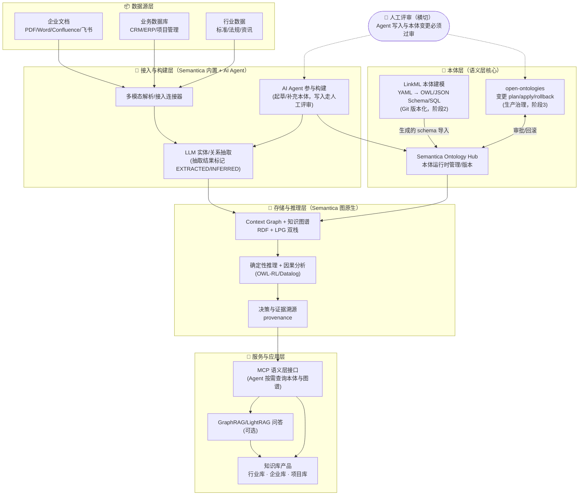

# 企业本体知识库参考架构设计（选型 + 衔接 + 架构图）

> 面向：公司产品内的行业知识库 / 企业知识库 / 项目知识库
> 原则：**一个主平台 + 少量标准组件，不做全家桶**。可行性优先，组件全部活跃维护（数据核实于 2026-11-02）。

## 一、直接回答：用一个还是全用？

**只用一个主平台：Semantica（14.4k★，MIT，今天仍在提交）。其余项目按需作局部增强，绝大多数不要同时上。**

| 角色 | 选它 | 不选/缓选谁 | 理由 |
|---|---|---|---|
| 主平台（本体+图谱+推理+溯源一体） | **Semantica** | Helix Foundry、Utopia、TrustGraph | 社区最大最活跃、MIT 无锁定、RDF+LPG 双栈兼容 W3C 标准；后三者各自是"另一种主平台"，与 Semantica **二选一**，不是叠加 |
| 本体建模（本体即代码） | **LinkML**（可选，第 2 阶段引入） | Protégé 手工编辑 | YAML 建模，一次生成 OWL/JSON Schema/SQL/GraphQL，工程团队用 Git 协作，告别手搓 OWL |
| 本体变更治理（上线后） | **open-ontologies**（可选，第 3 阶段引入） | — | 本体进生产后需要 plan/apply/rollback 审批，防止改崩 |
| 问答检索（可选） | **LightRAG**（40k★）或 Semantica 自带检索 | GraphRAG 同时上 | 二选一即可；LightRAG 轻量易集成 |
| 未来演进（不现在做） | EvoOntology（Data Agent 语义层）/ Utopia（强审计时态） | — | 需求出现再引入 |

**结论一句话：起步 = Semantica 单平台；1-2 个月后加 LinkML；本体进生产后加 open-ontologies。其余项目是备选路线，不是拼图。**

## 二、架构图

**衔接关系（数据怎么流）**：
1. 文档/库表/行业数据 → Semantica 连接器解析 → LLM 抽取实体关系（每条标注是抽取的还是推断的）→ 写入图谱；
2. 本体三件套：LinkML 管"设计时"（Git 里的 YAML）→ 导入 Semantica Ontology Hub 管"运行时" → open-ontologies 管"变更时"（上线后改本体要走审批）；
3. Agent 通过 MCP 接口读图谱/本体（带溯源），写入必须走人工评审；
4. 上层应用（三个知识库 + 可选 RAG 问答）只依赖 MCP 语义层，不直连存储。

## 三、每个组件负责什么、解决什么问题

| 层 | 组件 | 负责什么 | 解决的问题 |
|---|---|---|---|
| 接入构建 | Semantica 摄取 + LLM 抽取 | 把文档/库表变成图谱三元组 | 知识锁在文件和系统里、无法关联复用 |
| 接入构建 | AI Agent（Claude Code 等） | 起草本体的初稿、随业务演化补充 | 零基础冷启动：没有本体专家也能从 0 到 1 |
| 本体层 | LinkML | 本体即代码，Git 协作，多格式生成 | 本体只有一份手搓 OWL 文件、没人敢改、没法评审 |
| 本体层 | Semantica Ontology Hub | 运行时本体管理/版本 | 语义口径不统一（同一概念各部门叫法不同），AI 各说各话 |
| 本体层 | open-ontologies | 生产本体变更审批+回滚 | 本体改错一处、下游全崩，且无法追责回滚 |
| 存储推理 | RDF+LPG 图谱 + 推理 | 存储+推导隐含知识 | 纯向量 RAG 只会"找相似"，不会推理"谁向谁汇报、哪个项目依赖哪个合同" |
| 存储推理 | 溯源 provenance | 每条知识带证据 | 企业知识必须可信可审计，答错要能定位到源头 |
| 服务层 | MCP 语义层 | Agent 统一语义入口 | Agent 每次都要人肉解释数据口径；换了模型语义就漂移 |
| 应用层 | 三个知识库 + RAG | 面向业务的产品形态 | 行业/企业/项目三类知识统一在同一语义底座，而非三套孤岛 |

## 四、为什么可行性高（风险控制）

1. **单平台起步**：Semantica 一家覆盖 80% 需求（接入/本体/图谱/推理/溯源），`pip install semantica` 即起，集成面最小；
2. **每步可回退**：LinkML 的 YAML 在 Git 里，open-ontologies 支持回滚，图谱数据不动；
3. **Agent 写入有人工评审闸门**：LLM 起草的本体错误不会静默污染知识库；
4. **不锁定**：RDF/LPG 双栈 + W3C 标准 + MIT，未来换 Utopia（强时态审计）或加 EvoOntology（Data Agent）都是增量演进。

## 五、落地节奏

| 阶段 | 时间 | 做什么 | 验收 |
|---|---|---|---|
| 1 PoC | 1-2 周 | Semantica 单平台：接入 1 类企业文档 + 行业数据，Agent 起草初版本体，跑通"问答带溯源" | 能回答 10 个跨文档业务问题并给出证据 |
| 2 工程化 | 1-2 月 | 引入 LinkML 本体入 Git；项目知识库接入；MCP 对接内部 Agent | 本体变更有 PR 评审记录 |
| 3 生产化 | 3 月+ | open-ontologies 上线变更治理；按需加 LightRAG；评估 EvoOntology/Utopia | 本体变更可审批可回滚 |

> 备选轻量路线：只想 1 周内看效果 → 用 Helix Foundry（Agent 直接起草本体入图库），验证后再决定是否迁到 Semantica 正式栈。
